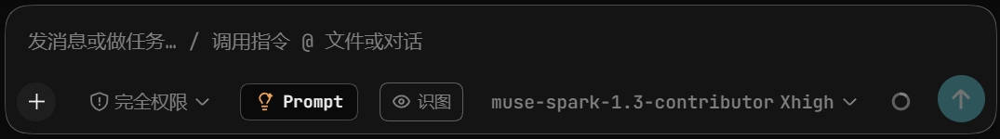
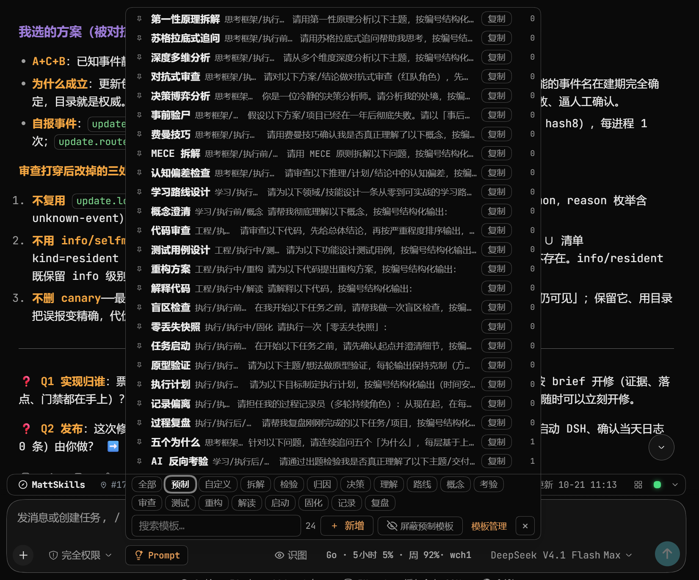
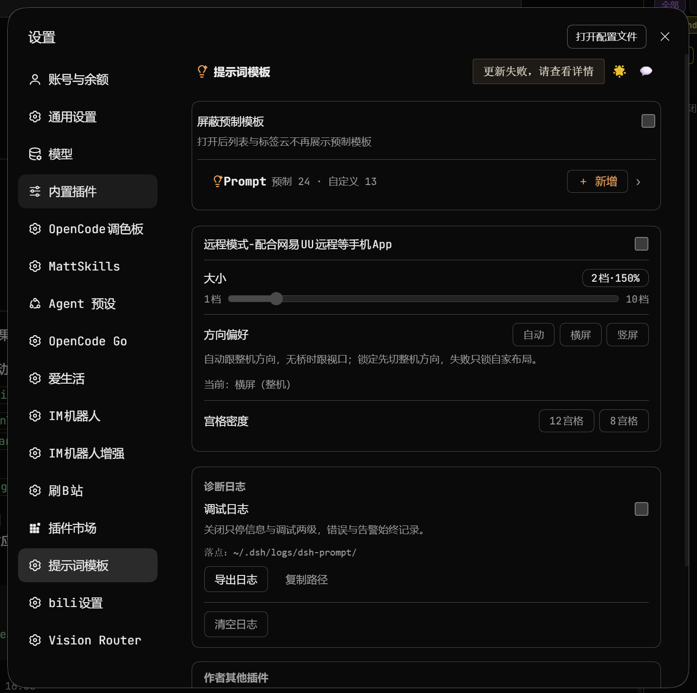
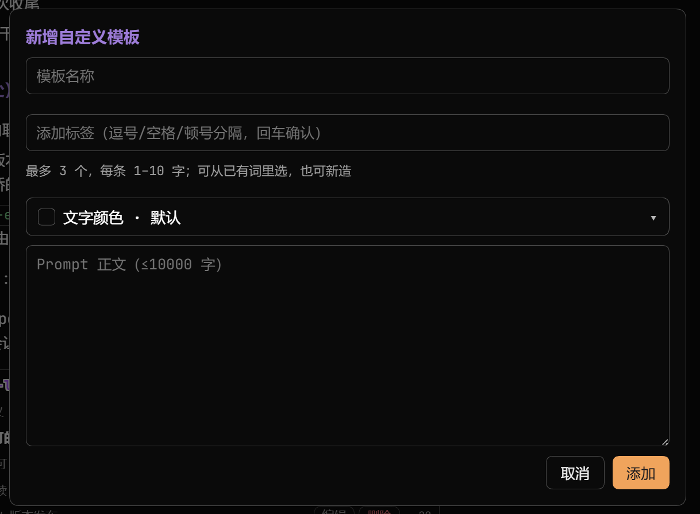
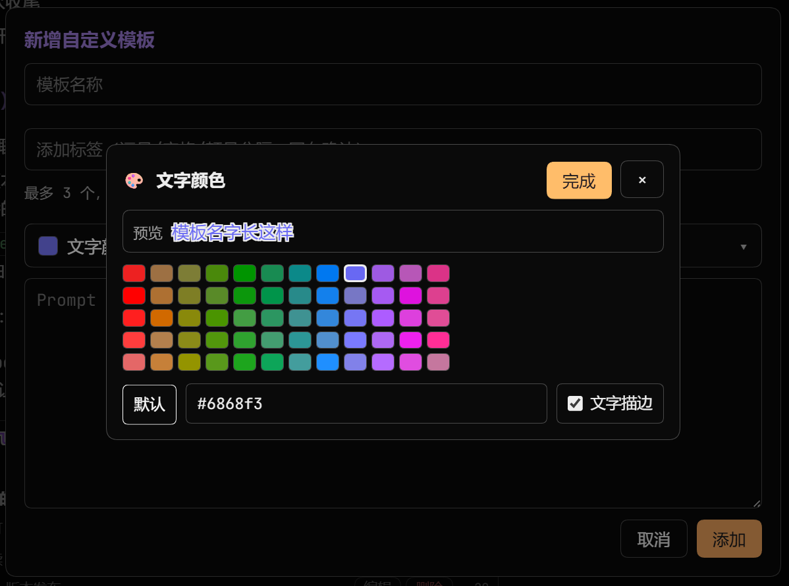
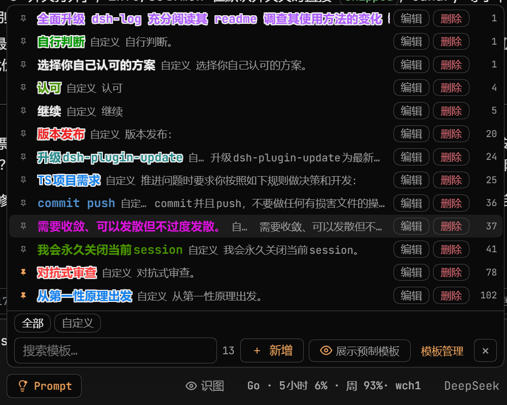

<h1 align="center">dsh-prompt</h1>

<div align="center">

**中文** · [English](docs/README.en.md)

**将所有重复的Prompt变成模板。**<br>
点击一下即可注入到对话框中。

你的 ⭐ 是我夜空中最亮的星。

*Stop copy-pasting — one click, template in chat.*

[](https://www.npmjs.com/package/dsh-prompt) [](https://www.npmjs.com/package/dsh-prompt) [](https://github.com/FeatherHunter/dsh-prompt/commits/main) [](https://github.com/FeatherHunter/dsh-prompt/graphs/commit-activity) [](https://github.com/FeatherHunter/dsh-prompt/issues)

</div>

<div align="center">

## 安装 <sub>INSTALL</sub>

</div>

<div align="center">

前置要求：[DSH](https://www.npmjs.com/package/@deepseek-ai/dsh)（DeepSeek Harness）。

</div>

```bash
# ① 安装 DSH CLI（已装跳过）
npm install -g @deepseek-ai/dsh

# ② 安装 dsh-prompt —— --profile 必填：装进你实际使用的 DSH 入口对应的 profile
#    （装错 profile 等于没装，重启多少次都不会加载）
dsh plugin --profile web add dsh-prompt     # 用自启 web 服务（dsh web）
#     或者
dsh plugin --profile desktop add dsh-prompt   # 用 DSH Desktop 桌面应用
# 锁定最新版更稳（当前 0.4.38）：
dsh plugin --profile web add dsh-prompt@0.4.38 --registry https://registry.npmjs.org
#     或者
dsh plugin --profile desktop add dsh-prompt@0.4.38 --registry https://registry.npmjs.org
```

<div align="center">

安装完成后重启一次DSH。

**👇 装完重启，输入框左侧多出这枚按钮就是成功。**



</div>

### 进阶安装

#### 更新不生效怎么办？

下面命令以 web profile 为例——**DSH Desktop 桌面应用用户请把所有 `--profile web` 换成 `--profile desktop`**。

```bash
# 更新被静默忽略时，显式指定官方源
dsh plugin --profile web add dsh-prompt@latest --registry https://registry.npmjs.org
```

#### 复制下面这段发给你的 AI，在AI帮助下进行安装

```text
请帮我安装 DeepSeek Harness 插件 dsh-prompt。先读仓库 README：https://github.com/FeatherHunter/dsh-prompt
先确认我实际使用的 DSH 入口对应哪个 profile（DSH Desktop 桌面应用 → desktop；自启 web 服务 → web），把插件装进正确的 profile；
然后自行检查环境并按需安装（已装的跳过），完成后简要汇报结果。
```

**升级**

```bash
dsh plugin --profile web update dsh-prompt   # 升级
```

**卸载**

```bash
dsh plugin --profile web remove dsh-prompt   # 卸载
```

<div align="center">

## 入口一<br>Prompt 按钮

</div>

<div align="center">

鼠标移到输入框左侧的「Prompt」按钮，列表自动展开——官方 24 条预制模板和自己攒的模板都在这里，范围、标签、搜索、用量一屏全在。

**👇 按钮一点，面板长这样。**



点底栏「屏蔽预制模板」，官方预制就收起来，只留自己攒的；再点「展示预制模板」又全铺开。

</div>

<div align="center">

## 入口二<br>/prompt 触发源

</div>

<div align="center">

输入框敲 `/prompt` 或者 `/p`。<br>
`/prompt 复盘`可以缩小范围。

**👇 /prompt 看到全部模板。**


</div>

<div align="center">

## 设置面板<br>SETTINGS

</div>

<div align="center">

**👇 设置面板提供各种功能。**



</div>

<div align="center">

## 自定义与管理<br>CUSTOM

</div>

<div align="center">

**👇 新增自定义Prompt提示词模板：名称、标签、文字颜色、正文一次配齐。**



**👇 文字颜色可以修改，支持文字描边。**



**👇 自定义提示词：可配置文字颜色。**



</div>

<div align="center">

## 作者的其他作品 <sub>MORE</sub>

</div>

<div align="left">

**[dsh-mattpocock-skills-deck](https://github.com/FeatherHunter/dsh-mattpocock-skills-deck)** —— 近 30 万 star 的 mattpocock/skills 整套预置好（27 个技能），装好即用。

**[dsh-opencode-palette](https://github.com/FeatherHunter/dsh-opencode-palette)** —— 38 款 opencode 经典配色 + 20+自定义主题 一键换装 DSH。

**[dsh-im-companion](https://github.com/FeatherHunter/dsh-im-companion)** —— 给 dsh-im 加了「助理」和「家」的概念。

**[ilife](https://github.com/FeatherHunter/ilife)** —— ⚠️建设中⚠️爱生活：居家生活套件，记账、运动、饮食、体重、食谱、物品管理、作息规划、备忘录等。

</div>

<div align="center">

## 致谢 <sub>THANKS</sub>

</div>

<div align="left">

有任何问题、建议、想法、IDEA、灵感、随谈：欢迎提交 [ISSUE](https://github.com/FeatherHunter/dsh-prompt/issues)🌹

感谢每一位提交 Issue、PR 与Star的朋友，是你们让这个工具箱一点点变好。万分感谢！🎉🎉🎉🎉🎉🎉🎉🎉🎉

<!-- THANKS-TABLE-ZH-START -->
| 贡献者 | 致敬 | 贡献 |
| --- | --- | --- |
| [@wqzhellohhwy](https://github.com/wqzhellohhwy) | 🌹🌹🌹 | [#146](https://github.com/FeatherHunter/dsh-prompt/issues/146) [#147](https://github.com/FeatherHunter/dsh-prompt/issues/147) [#148](https://github.com/FeatherHunter/dsh-prompt/issues/148) |
| [@dagangwo](https://github.com/dagangwo) | 🌹 | [#175](https://github.com/FeatherHunter/dsh-prompt/issues/175) |
| [@jheroy](https://github.com/jheroy) | 🌹 | [#165](https://github.com/FeatherHunter/dsh-prompt/issues/165) |
<!-- THANKS-TABLE-ZH-END -->

</div>

---

<h2 align="center"><sub>CONNECT</sub><br>反馈与联系</h2>

<div align="center">

👏欢迎提交PR、ISSUE。星星之火可以燎原🔥有任何建议、意见、想法、吐槽、idea都可以进群交流。

<table align="center"><tr><td align="center"><b>QQ群</b></td><td align="center"><b>微信群</b></td><td align="center"><b>飞书群</b></td></tr><tr><td></td><td></td><td></td></tr></table>

</div>

<div align="center">


</div>

