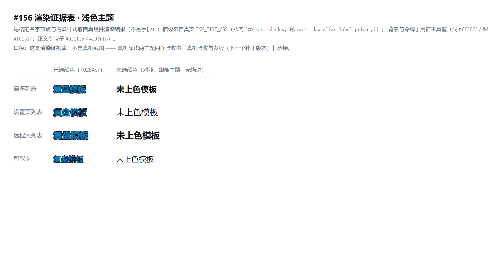
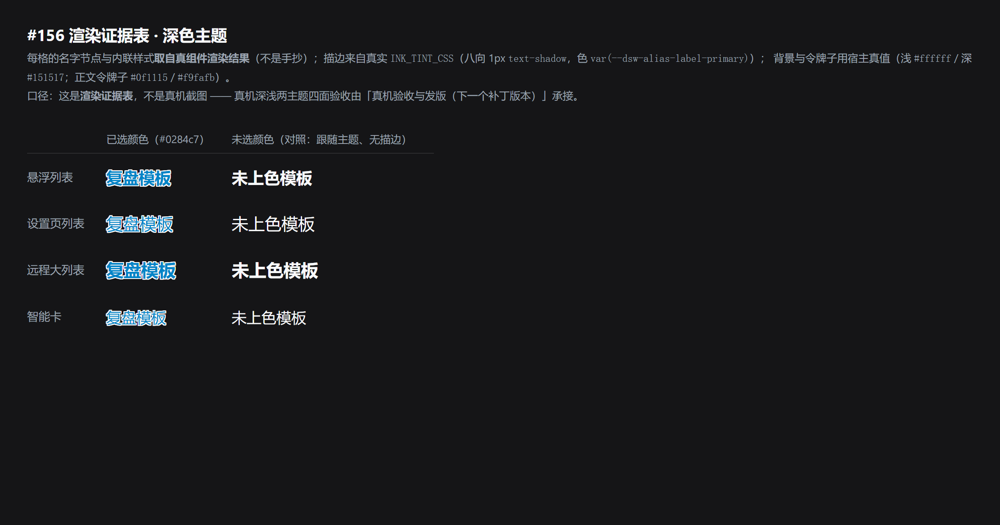

# 渲染证据表：颜色标签在四个面 × 深浅两主题

这张笔记是 #156 的交付物之一：颜色标签落地后，四处模板名在深浅两主题下的**渲染证据**。
它回答的是「同一份颜色语义在四个面同源、且带外值回落成未选颜色」到底长什么样，而不是「真机上好不好看」。





## 它凭什么算证据

- **名字节点与内联样式取自真组件渲染结果**：悬浮列表、设置页列表、远程大列表、智能卡四处各挂真组件
  （`react-test-renderer`），远程面先认 `data-dsh-prompt-remote-panel`，再沿 `data-dsh-prompt-remote-card`
  翻页定位目标卡（自定义项不一定落在第一页）。不是手抄的示意节点。
- **描边来自真实样式段**：`src/client/panel.ts` 的 `INK_TINT_CSS`（八向 1px `text-shadow`，色
  `var(--dsw-alias-label-primary)`）原样注入页面。
- **背景与令牌子用宿主真值**：浅 `#ffffff` / 深 `#151517`；正文令牌子浅 `#0f1115` / 深 `#f9fafb`。
  所以「浅色黑描边、深色白描边」是令牌翻转的结果，不是两套写死的颜色。

## 怎么复现

```powershell
node scripts/render-ink-evidence.cjs   # 生成 .wayfinder/ink-evidence/{light,dark}.html，并打印下面两条命令
& "$env:ProgramFiles\Google\Chrome\Application\chrome.exe" --headless=new --disable-gpu --hide-scrollbars `
  --force-device-scale-factor=2 --window-size=1180,620 `
  --screenshot=research/assets/ink-color/faces-light.png "file:///<仓库>/.wayfinder/ink-evidence/light.html"
# 深色：把 light 换成 dark，输出 faces-dark.png
```

## 边界（这张图**不是**什么）

- 它**不是真机截图**：本环境没有可驱动真 GUI 的通道。真机深浅两主题四面验收由
  「真机验收与发版（下一个补丁版本）」承接。
- 它**不判观感**：色板与描边粗细的观感定稿在 `prototype/ink-color/compare.png`（原型票）。
- 它**不替代回归**：跨面契约、带外回落、零写回、零新造色值由 `scripts/test-issue-156.cjs` 断言；
  控件的形状与交互、注入缝的归属标记由 `scripts/test-issue-158.cjs` 断言。
