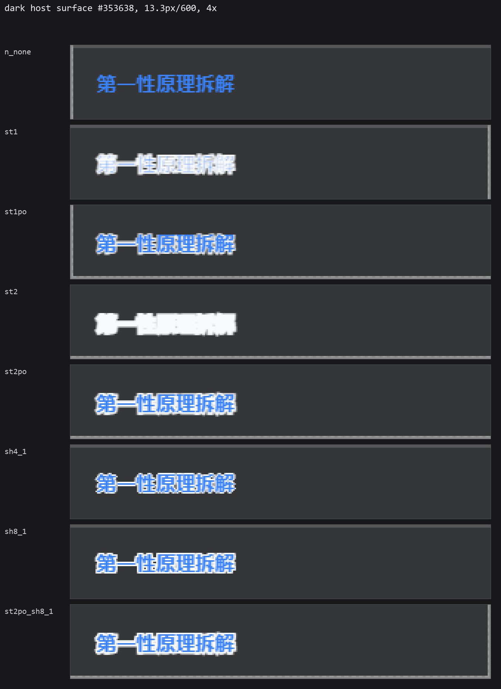
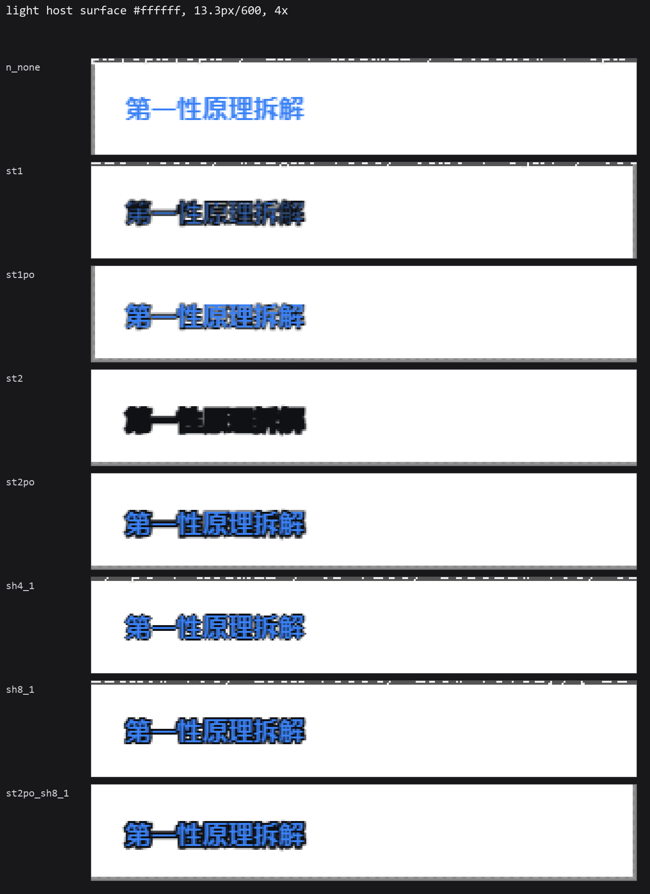
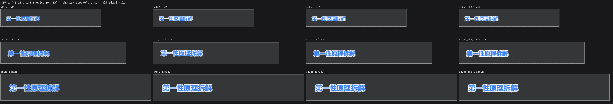
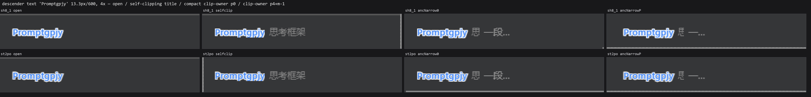

# 模板名「染色 + 描边」的渲染实现研究：技术选型 / 裁切 / 令牌 / 主题实时性

- 日期：2026-10-14
- 问题（只此四问）：
  1. **技术选型**：`text-shadow` 四/八向 1px 环 vs `-webkit-text-stroke`（含 `paint-order: stroke fill` 在 Chromium 的真实支持与语义）vs 两者组合。在 13.3px/600 与 14.28px/700 下哪种不啃字形、不发糊；DPR 1 / 1.25 / 1.5 是否退化。
  2. **裁切**：`white-space:nowrap; overflow:hidden; text-overflow:ellipsis` 的行里，外描边会不会被裁、`-webkit-text-stroke` 会不会被裁；量出实际像素差；给补偿代价最小的写法，并说明是否顶破行高预算。
  3. **证实/证伪**：描边色直接用 `var(--dsw-alias-label-primary)` ⇒ 一条 CSS 同时拿到「深色白描边、浅色黑描边」，免 `data-ds-dark-theme` 分支、免写死颜色。第三方用 `ctx.theme` 覆盖令牌时会怎样；给可直接抄进 `src/client/` 的 CSS 片段（注入必须经 `src/client/styleOwnership.ts` 打 `data-plugin='dsh-prompt'`）。
  4. **主题实时性**：手动切 light/dark/system 时纯 CSS 是否即时跟随；桌面 Electron 与纯浏览器 `http://127.0.0.1:19387` 的行为差异；注入的 `@media (prefers-color-scheme: dark)` 在两者下分别如何。
- 状态：**四问已答完**；未证实的部分集中在 §6
- 关联：`research/ink-contrast-floor.md`（同一需求的姊妹篇：可读性下限/色板/取色控件）、`research/host-font-scale-bridge.md`（体例对齐）
- 只读声明：不改 `src/`、`lib/`、`scripts/`、`package.json`；本文件与 `.wayfinder/research-assets/ink-stroke/**` 为唯一产物。

## 0. 被测面（仓内证据，先钉死行号）

四个名字 span（行号比需求描述里的 +3，已按当前工作区核准）：

| 站点 | 名字 span 内联样式 | 谁裁它 |
| --- | --- | --- |
| 紧凑卡片行名 | `src/client/panel.ts:1629`：`fontSize:'0.95em'`、`fontWeight:600`、`whiteSpace:'nowrap'`、`flex:'none'` | 宿主 `src/client/panel.ts:1628`：`{flex:1,minWidth:0,display:'flex',alignItems:'baseline',gap:6,overflow:'hidden'}`；行根 `src/client/panel.ts:1620`（`{...itemStyle,background,outline,minWidth:0}`，`itemStyle` 在 `src/client/panel.ts:1130`，`padding: compact?'3px 6px':'4px 2px'`）**不裁** |
| 远程卡片标题 | `src/client/panel.ts:1281-1284` `remoteCardTitle`：`1.02em`、`700`、`whiteSpace:'nowrap'`、`overflow:'hidden'`、`textOverflow:'ellipsis'`、`flex:'none'`（用于 `src/client/panel.ts:1424`） | 自己 + 行 |
| 设置区紧凑行名 | `src/client/panel.ts:1135` `nmStyle`：`0.98em`、`500`、`overflow:'hidden'`、`textOverflow:'ellipsis'`（用于 `src/client/panel.ts:1656`） | 自己 + 行 `src/client/panel.ts:1654`（`overflow:'hidden'`） |
| 智能面板行名 | `src/client/smart.ts:361` `rowName`：`0.88em`、`500`、`maxWidth:90`、`overflow:'hidden'`、`textOverflow:'ellipsis'`（用于 `src/client/smart.ts:380`） | 自己 + 行 `src/client/smart.ts:355-359`（`overflow:'hidden'`） |

字号推导：面板根 `fontSize` = `calc(var(--dsw-font-markdown-base-font-size) * uiFontScale)`（`src/client/panel.ts:1100`）/ `scaledBaseFontSize(...)`（`src/client/panel.ts:1105`）；该令牌 = `var(--dsh-content-font-size,14px)`（`.dsh-extract/theme-css/gradient_shadow_text_css_default.css:1`，同一处还给出 `--dsw-font-markdown-base-line-height:calc(24px + delta)` 等**令牌**声明），宿主默认 14px（`@deepseek-ai/dsh-client-ui-theme/lib/index.js:82`：`fontSize: z.number().step(1).min(10).max(22).default(14)`）⇒ **0.95em = 13.3px**、0.98em = 13.72px、**1.02em = 14.28px**、0.88em = 12.32px。宿主字号可调 10..22px ⇒ 名字实际落在 9.5..20.9px。

字体与行高（决定垂直余量的关键）：

- 宿主字体栈 `.dsh-extract/theme-css/base_css_default.css:1`（Windows → Segoe UI + Microsoft YaHei）。
- 宿主**全部样式表没有任何"选择器级" `line-height`**（`base_css` / `design_platform` / `scrollbar` / `shiki` 等 0 处；只有 `gradient_shadow_text_css_default*` 里的 `--dsw-font-*` 令牌声明 30 行）⇒ 名字 span 的 `line-height` 仍是 `normal`。Chromium 155 本机实测：**13.3px → 行盒 17px**，**14.28px → 行盒 19px**。

实测环境（`.wayfinder/research-assets/ink-stroke/`，只读仓、仅写该目录；4 张 `fig*.png` 已复制到 `research/assets/ink-stroke/`，因为 `.wayfinder/` 被 `.gitignore` 忽略、正文图片链接必须指向被跟踪的复制件）：

- Chrome `155.0.8059.79` `--headless=new --disable-gpu --disable-lcd-text --font-render-hinting=none`，`--force-device-scale-factor=1|1.25|1.5`。
- `stroke.html`（760 例对照页：4 个宿主真实背景 `#ffffff / #232324 / #2c2c2e / #353638` × 2 字号 × 12 技术 × 10 种裁切/补偿姿态）+ `run.py`（截图 + 逐例像素分类：与背景/填色/描边色的最大通道距离阈值 24，统计 `ink_px / fill_px / stroke_px / mid_px`、墨迹 bbox、行盒/裁切盒矩形、四边内外 1px 带的像素数）。
- `tokenprobe.html` + `tokenprobe.py`：直接 `<link>` 宿主真实样式表（`.dsh-extract/theme-css/base_css_default.css`、`design_platform_css_default.css`），在纯红探针面上数"精确等于描边色"的像素，验证令牌方案；并含"不可见描边"隔离实验。
- `bandan.py`（按标题盒量四边带）、`clipan.py`、`figs_ink.py`（出图）。复现：`cd .wayfinder/research-assets/ink-stroke; python run.py shot; python tokenprobe.py; python figs_ink.py`。
- 渲染尺寸（同一份 760 例对照页，文档 1686×6854 CSS px）：dsf1 → `stroke_dsf1.png` **1726×6894**、dsf1.25 → **2684×10759**、dsf1.5 → **3854×15482**；逐例单元格 280×46 CSS px，名字行盒 13.3px 文本 = 17px、14.28px 文本 = 19px。

## 1. 技术选型

**答案：用八向 1px `text-shadow`（四个正交 + 四个对角），描边色取宿主令牌。**
`-webkit-text-stroke` 单独用**必须**配 `paint-order: stroke fill`，否则在 13.3px/14.28px 下 1px 宽度就把字形填色全部吃掉；配了 `paint-order` 后它可用，但外露的只是半个像素的外环，环弱且**DPR 1.25 时崩**。要更厚的硬边就用**组合**：`-webkit-text-stroke:2px` + `paint-order:stroke fill`（或再加八向 1px 阴影）。

### 1.1 不啃字形（fill 像素，深色面 `#353638`、`第一性原理拆解`、13.3px/600、dsf1）

| 技术 | fill_px | 相对基准 | 说明 |
| --- | --- | --- | --- |
| `n_none`（基准） | **342** | — | 无描边 |
| `sh4_1` / `sh8_1`（四/八向 1px shadow） | **342** | **0%** | 逐像素不变 |
| `sh8_2`（八向 2px） | 342 | 0% | 逐像素不变 |
| `st1`（1px stroke，**无** paint-order） | **0** | **−100%** | 字形被描边色完全覆盖 |
| `st2`（2px stroke，无 paint-order） | **0** | −100% | 同上，更彻底 |
| `st1po`（1px + `paint-order:stroke fill`） | 354 | +3.5% | fill 完好（+3.5% 是 AA 像素改判） |
| `st2po`（2px + `paint-order:stroke fill`） | **342** | **0%** | 逐像素不变 |
| `st2po_sh8_1`（组合） | 342 | 0% | 逐像素不变 |

14.28px/700（同面同文本）：基准 390；`sh8_1` 390（0%）、`st2po` 390（0%）、`st2po_sh8_1` 390、`st1po` 403（+3.3%）、`st1` **2**（−99.5%）、`st2` **0**（−100%）。
浅色面 `#ffffff`（描边色 `#0f1115`）同型：基准 342；`sh8_1` 338（−1.2%）、`st2po` 338、`st1po` 362（+5.8%）、`st1`/`st2` **0**。三个 DPR 下结论一致（`st1` 的 fill 相对基准是 −100.0% / −99.0% / −97.8%，即 342 → 0 / 3 / 8 像素，各 DPR 都被吃光）。

### 1.2 不发糊：环的"实心度"与 DPR 稳定性（同面同文本，13.3px/600）

`stroke_px` = 精确等于描边色的像素数（全强度环像素）；`pk%` = `stroke_px / (ink_px − 基准 ink_px)`，即外扩出来的墨迹里有多少是实心描边色。

| 技术 | dsf1 | dsf1.25 | dsf1.5 |
| --- | --- | --- | --- |
| `sh8_1` | **390 px / 85%** | **404 px / 65%** | **796 px / 82%** |
| `sh4_1` | 244 / 59% | 197 / 36% | 485 / 57% |
| `sh8_2` | 605 / 87% | 853 / 77% | 1295 / 83% |
| `st2po` | 378 / 62% | 310 / 49% | 635 / 65% |
| `st1po` | 185 / 41% | **43 / 11%** | 151 / 22% |
| `em075po`（宽度写 `0.075em`） | 185 / 41% | 43 / 11% | 148 / 21% |
| `st2po_sh8_1` | 464 / 76% | 496 / 76% | 849 / 79% |

读法：

- **四向 shadow 留对角缺口**（pk 只有 36..59%）：`±1px 0` / `0 ±1px` 四条在 45° 方向够不着，字角是虚的。八向补齐（pk 65..85%）。→ 用八向，别用四向。
- **`-webkit-text-stroke` 的外露环天生是"半个像素"**：描边以字形轮廓为中心线（SVG 描边模型），1px 宽的可见部分只在轮廓外 0.5px；`st1po` 因此只有 185 px 实心环，且在 **DPR 1.25 掉到 43 px（−77%）**——这就是"发糊"的量化形态（分数 DPR 下那半像素被 AA 摊平）。同一 DPR 下 `sh8_1` 反而从 390 涨到 404。
- **DPR 结论**：整数像素位移的技术（shadow）在 DPR 1/1.25/1.5 都稳定；半像素外环技术（1px stroke + paint-order）在 **DPR 1.25 明显退化**。fill 侵蚀与 DPR 无关（除 `st1`/`st2` 永远为 −100%）。
- 14.28px/700 同型：`sh8_1` 411/455/846（83/69/77%）、`st2po` 471/384/731（66/106/60%）、`st1po` 218/52/231（38/40/29%）。

### 1.3 一手依据

- MDN `paint-order`（https://developer.mozilla.org/en-US/docs/Web/CSS/paint-order）：*Baseline / Widely available … available across browsers since March 2024*；`Applies to: text elements`；并明写 "markers … do not apply to HTML text, so in that case, you can only determine the order of `stroke` and `fill`"，页面里就有 "Reversing the paint order of stroke and fill **using HTML**"（配 `-webkit-text-stroke-color/width`）的例子 ⇒ `paint-order: stroke fill` 对 HTML 文本是一等公民，不是 SVG 专属。本仓实测复核：`getComputedStyle(span).paintOrder === 'stroke'`（`tokenprobe.json`），且 fill 精确回到基准。
- MDN `-webkit-text-stroke`（https://developer.mozilla.org/en-US/docs/Web/CSS/-webkit-text-stroke）：*Baseline / Widely available … since April 2017*；`Applies to: all elements`；width+color 的简写。**MDN 不写"描边居中"**；居中来自 SVG 描边模型（描边以轮廓为中心线），本仓实测与该模型一致（§1.1：无 paint-order 时 1px 就把 fill 归零，正说明有一半甚至更多覆盖在字形内部）。
- **额外实测（隔离实验）**：`-webkit-text-stroke` **不会**改变字形的栅格化。用不可见描边 `-webkit-text-stroke:0.05px transparent` 与 `1px transparent`（都配 `paint-order:stroke fill`，fill 仍压在上层）对比无描边基准：明暗两种主题下 ink bbox 都是 `93×14`、`ink_px` 都是 `817` = 基准值（`tokenprobe.py` 输出）。⇒ 描边只是"多画了一圈轮廓"，字形/hinting 不动；`st2po` 的墨迹外扩比朴素预期略大（14.28px 面：反推外扩 +1 设备像素/侧）。

图（4× 最近邻放大，`research/` 相对路径）：

- 
- ：对照页里 `st1`/`st2` 两行是白/黑糊成一团，`st1po` 字还清楚但白边极细，`sh8_1`/`st2po` 都干净。
- ：同一行里 `st1po` 在 dsf1.25 那格几乎看不到边。

## 2. 裁切与补偿

**答案：会裁，两种技术一视同仁**（都属于 ink overflow，`overflow:hidden` 在 padding box 上裁，画到盒外的环按像素消失）。
对**真实模板名（4–7 个汉字）代价极小**：13.3px/深色面忠实复刻里，环像素只掉 0.5–1.3%（`sh8_1` 390→387、`st2po` 378→376；14.28px 同样 −2..−5 px），唯一可测形变是 `st2po` 底边被切平 1 设备像素（墨迹高 17→16）。
**最坏情况是带下伸部的拉丁名**：基准行盒底只剩 0.5px 余量（`over_bottom` −0.5），任何 1px 外环都越界 → 行盒下方 3px 带内原本 20 个全强度环像素（`sh8_1`）/14 个（`st2po`）**裁切后为 0**，总环像素 −8.2%…−11.8%。

### 2.1 量到的数字（深色面 `#353638`、13.3px/600；单位=设备像素）

`over_bottom` = 墨迹 bbox 下沿 − 标题盒下沿（负 = 还在盒内）：

| 技术 | 基准（无描边）`over_bottom` / 墨迹高 | 加环后 `over_bottom` / 墨迹高 | 环外扩 |
| --- | --- | --- | --- |
| `sh8_1`，cjk7 | −2.5 / 12 | **−1.5 / 14** | 每侧 +1（盒内还剩 1.5px 余量） |
| `st2po`，cjk7 | −2.5 / 12 | **+0.5 / 17** | 越界 0.5px（会被切平） |
| `sh8_1`，带下伸部 `Promptgpjy` | −0.5 / 13 | **+0.5 / 15** | 越界 0.5px |
| `st2po`，带下伸部 | −0.5 / 13 | **+1.5 / 16** | 越界 1.5px |
| `sh8_1`，cjk7，14.28px | −3.5 / 12 | −2.5 / 14 | 不越界 |
| `st2po`，cjk7，14.28px | −3.5 / 12 | −0.5 / 17 | 不越界 |

裁切模式对比（`环像素 = stroke_px`；`open` = 不裁基准；`selfclip` = 名字 span 自己 `overflow:hidden;text-overflow:ellipsis` 且行也裁 = 设置区/智能面板姿态；`ancNarrow0` = 忠实复刻紧凑卡片行（裁切宿主 padding 0）；`ancNarrowP/ancclip` = 裁切宿主加 3–4px padding（+负 margin））：

| 文本 / 技术 | open | selfclip | ancNarrow0（padding 0） | ancNarrowP（padding 4px + margin −1px） |
| --- | --- | --- | --- | --- |
| cjk7 / `sh8_1` @dsf1 | 390 | 386 (−1.0%) | 387 (−0.8%) | **390（0）** |
| cjk7 / `st2po` @dsf1 | 378 | 373 (−1.3%) | 376 (−0.5%) | **378（0）** |
| cjk7 / `sh8_1` @dsf1.25 | 404 | 388 (−4.0%) | 399 (−1.2%) | 390 (−3.5%) |
| cjk7 / `sh8_1` @dsf1.5 | 796 | 779 (−2.1%) | 789 (−0.9%) | **796（0）** |
| 带下伸部 / `sh8_1` @dsf1 | 280 | 257 (−8.2%) | **280（0）** | **280（0）** |
| 带下伸部 / `st2po` @dsf1 | 149 | 133 (−10.7%) | **149（0）** | **149（0）** |
| 带下伸部 / `sh8_1` @dsf1.25 | 421 | 384 (−8.8%) | 388 (−7.8%) | 426 (+1.2%) |
| 带下伸部 / `sh8_1` @dsf1.5 | 714 | 648 (−9.2%) | 653 (−8.5%) | **714（0）** |

补一个更细的定位（带下伸部、`sh8_1`、dsf1）：以标题盒四边为基准各取外侧 3px 带，`open` 在**下方带**有 20 个全强度环像素（+29 个含 AA 的墨迹像素）、右侧带 3 个、左侧带 0 个实心（11 个 AA 像素）；`selfclip` 三个带全部为 0；`ancNarrowP` 与 `open` 完全一致。⇒ 掉的正是下方 1 设备像素行 + 左侧 AA 边。

### 2.2 代价最小的补偿写法

1. **裁切盒 = padding box**，所以给**裁切宿主**加纵向 padding 就是全部修法：`padding-block: 2px; margin-block: -2px`。
   - 实测有效：`padding:4px 6px; margin:-1px 0`（`ancNarrowP`）在 4 组（13.3/14.28 × cjk7/带下伸部）配置里环像素损失为 **0**（dsf1、dsf1.5；dsf1.25 也在 ±1% 内）。`padding:0` 的忠实复刻在 dsf1 对带下伸部文本也恰好不丢（因为那一姿态的裁切盒比名字行盒高 1px），但 dsf1.25/1.5 就掉 8%（见上表）⇒ **别赌余量，直接给 2px**。
   - **只给名字 span 加 padding 没用**：`selfclipPxy`（标题 `padding:1px;margin:-1px`）与 `selfclip` 同为 −3..−23 px，`selfclipB` 亦然。只要外层还裁，内层 span 的 padding box 扩张不改变外层的裁切矩形。
   - 落到本仓：`src/client/panel.ts:1628`、`src/client/panel.ts:1654`、`src/client/smart.ts:355-359` 这 3 个"裁切宿主"各加 `paddingBlock: 2, marginBlock: -2`（名字 span 不动，或只补横向 `marginInline:-1`）。`remoteCardTitle`（`src/client/panel.ts:1281-1284`）与 `nmStyle`/`rowName` 自身也 `overflow:hidden`，它们**自己**也各加一份。
2. **行高预算**：padding 只把 border box 撑大（实测 `selfRowP` 行盒 17→19），配等量负 margin 后**外边距盒不变**⇒ 行根（`src/client/panel.ts:1620`，`padding:3px 6px`，不裁）的布局高度不变，多出来的 1–2px 环正好落在行根自己的 3px padding 里，不会压到相邻行。**不加负 margin** 则每行 +4px（深色面 23px 行高 +17%），这就是唯一需要盯的预算项。
3. 横向（截断那头）：`text-overflow:ellipsis` 的 `…` 与被截断文本同属一个文本 run，`text-shadow`/`-webkit-text-stroke` 一起作用在 `…` 上；`…` 右缘的 1px 外环同样会被裁平。横向补偿同上（`paddingInline:1px; marginInline:-1px` 给裁切宿主），代价是行内兄弟文本少 2px 宽度（`flex:1 1 auto` 的简介会吸收）。实测横向损失全是 AA 边像素（左侧带 0 个实心像素 / 11 个 AA 像素），**视觉上可忽略**。
   > **更正（2026-10-20，issue #176）**：本条的「视觉上可忽略」在真机上**不成立** —— 合成 harness 测的是 1/1.25/1.5 三档 device scale factor，真机 175% 下每行**第一个字左缘**的 1px 环被裁切盒削掉一半（保留 52%），100% 档下整列被削（保留 0%），肉眼可见「第一个字左边少了几个像素点」。是否被削取决于首字字形左边界离文字原点多远（宽体 CJK 字与拉丁字母会，窄字不会）。**横向补偿的量也改了**：本条写的 1px 不够（环宽 1px 时环外缘正压裁切线，AA 外溢被削；拉丁首名 @150% 只保住 50%）⇒ 落到本仓的是 `paddingInline:2, marginInline:-2`。实测矩阵与修法见 `research/ink-ring-horizontal-clip/findings.md`，契约门禁 `scripts/repro/test-issue-176.cjs`（`npm run check:issue-176`）。
4. 若只想要"绝不越界"的稳妥解：用八向 1px shadow（`over_bottom` −1.5，盒内还有 1.5px 余量），CJK 名零补偿即可；`st2po` 那条 1px 外环必须靠 §2.2 第 1 条喂余量。



## 3. 令牌方案

**证实。** 一条规则、零分支、零写死颜色。

### 3.1 实测（`tokenprobe.html` 直接 link 宿主真实样式表）

| | 浅色（无属性） | 深色（`body[data-ds-dark-theme]`） |
| --- | --- | --- |
| `--dsw-alias-label-primary` 计算值 | `#0f1115` | `#f9fafb` |
| 八向 shadow 的 computed `text-shadow` 颜色 | `rgb(15, 17, 21)` | `rgb(249, 250, 251)` |
| 纯红探针面上"精确等于描边色"的像素 | `#0f1115` × **12** | `#f9fafb` × **67** |
| `-webkit-text-stroke-color` / `stroke_px` | `rgb(15,17,21)` / **35** | `rgb(249,250,251)` / **37** |
| 无描边基准的精确像素 | 0 | 0 |

（同一页 `paint-order` 计算值为 `stroke`；`color-scheme` 需自己设，宿主在 `dsh-client-ui-layout/lib/client.js:534` 写 inline `documentElement.style.colorScheme`。）

- 反向证据（别用错令牌）：`--dsw-alias-label-primary-foreground` 是**反色**——浅色 `#fff`（`.dsh-extract/theme-css/design_platform_css_default.pretty.css:208`）、深色 `#0f1115`（`:322`）。用它当描边色会得到"深色主题黑边"。
- `light-dark()` 也能用（探针实测浅色 `rgb(15,17,21)`、深色 `rgb(249,250,251)`，靠宿主的 inline `color-scheme`），但它把两个颜色写死在 CSS 里、**无视第三方令牌覆盖** ⇒ 不如令牌，仅在"必须与宿主配色解耦"时才考虑。

### 3.2 第三方用 `ctx.theme` 覆盖令牌时会怎样

- `--dsw-alias-label-primary` 在宿主的可覆盖令牌注册表里：`@deepseek-ai/dsh-client-ui-theme/lib/client.js:1285`（`BUILTIN_INSPECT_TOKENS`，`requiresLightAndDark: true`；同表还有 label-secondary `:1292`、bg-layer-1 `:1243`、bg-layer-2 `:1250`、border-l1 `:1264`）。
- 覆盖层按"当前配色"逐令牌折叠，后者覆盖前者：`composeActive`（`@deepseek-ai/dsh-client-ui-theme/lib/client.js:1506-1514`）；值必须是 `{light, dark}` 一对，裸字符串会被 `validateOverrides`（`:1540-1552`）抛 `TypeError`（"…is a bare string — pass { light: …, dark: … }… a single value goes illegible when the user switches color scheme"）。
- 结论：第三方换主题时我们的描边色**自动跟着换**，而且换到的仍然是"该主题下的正文色"——它天然是与该主题背景对比度最高的那个颜色，可读性责任与宿主自己的文字完全一致。唯一残余风险不是 bug：如果某个主题把正文色设成中间调（如 `#888`），白描边的强度会随之下降；若主题把正文色设成与用户选的染色**同一个值**，环会看不见（视觉上退化成纯染色，无害）。

### 3.3 可直接抄进 `src/client/` 的片段

注入必须走 `src/client/styleOwnership.ts`（`ensureOwnedStyleTag` / `markOwnedStyleTag`，`STYLE_OWNER_ID='dsh-prompt'`、`STYLE_OWNER_ATTR='data-plugin'`、`STYLE_MARKER_ATTR='data-dsh-prompt-style'`）：

```ts
import { ensureOwnedStyleTag } from './styleOwnership';
const tag = ensureOwnedStyleTag(document);   // 打上 data-plugin='dsh-prompt'（幂等）
tag.textContent = `
/* 只有被染色的名字带 data-dsh-prompt-tint：未选色 → 无属性 → 无描边 */
[data-dsh-prompt-tint]{
  text-shadow:
     1px 0 0 var(--dsw-alias-label-primary), -1px 0 0 var(--dsw-alias-label-primary),
     0 1px 0 var(--dsw-alias-label-primary),  0 -1px 0 var(--dsw-alias-label-primary),
     1px 1px 0 var(--dsw-alias-label-primary), -1px 1px 0 var(--dsw-alias-label-primary),
     1px -1px 0 var(--dsw-alias-label-primary), -1px -1px 0 var(--dsw-alias-label-primary);
}`;
```

要 2px 硬边时，把上面那段换成：

```css
[data-dsh-prompt-tint]{
  paint-order: stroke fill;                       /* 少了这行 fill 会被吃光 */
  -webkit-text-stroke: 2px var(--dsw-alias-label-primary);
}
```

两个前置条件（本仓现状）：

1. 四个名字 span 现在**没有类名/属性钩子**，内联 style 是唯一抓手 ⇒ 需要在 4 处 JSX 里加 `data-dsh-prompt-tint`（`src/client/panel.ts:1629`、`:1281-1284`、`:1135`、`src/client/smart.ts:361`）；未选色时不加该属性，天然满足"不选色不描边"。
2. **不要**把 `textShadow` 写进内联 style——内联优先级高于注入的规则，会把描边方案焊死。要么只用属性开关，要么在注入规则里用 `!important`（不推荐，后续难维护）。

## 4. 主题实时性

**答案：纯 CSS 即时跟随，不需要任何 JS。**

- 切主题时 `ThemePresenter.apply(snapshot)`（`@deepseek-ai/dsh-client-ui-layout/lib/client.js:532-548`）在一次同步调用里做完：`document.documentElement.style.colorScheme = scheme`（`:534`）、`setAttribute('data-ds-theme-source', …)`（`:535`）、`body` 增删 `data-ds-dark-theme`（`:537-538`）、再逐条 `body.style.setProperty(token, value)`（`:542-545`，同时先撤掉上一轮 `:540-541`）。我们的规则读的是令牌**值**，重绘即新色，没有需要监听的中间状态；`dispose()`（`:553-562`）会把这些全部收回。
- 首帧同样安全：引导脚本 `@deepseek-ai/dsh-client-ui-theme/lib/index.js:48-57` 在 React 挂载前就写 `document.documentElement.dataset.dsThemeSource`、`document.body.toggleAttribute('data-ds-dark-theme', dark)`（`dark = preference==='dark' || (preference==='system' && matchMedia('(prefers-color-scheme: dark)').matches)`）与 `--dsh-content-font-size`。
- Electron 与浏览器的差异（这是唯一的分叉点）：
  - 桌面版：`lib/preload-app.cjs:73-99` 用 `MutationObserver`（`attributeFilter: ['data-ds-theme-source']`）盯根元素，把值经 `electron.ipcRenderer.send(DESKTOP_IPC.nativeThemeSet, value)` 送主进程设 `nativeTheme.themeSource`；文件里自带的一手注释写明 "Native chrome and renderer `prefers-color-scheme` queries on every platform then follow the app's theme preference instead of the OS appearance while `system` keeps following the OS"。Electron 官方文档（https://www.electronjs.org/docs/latest/api/native-theme）逐条对应：`themeSource='dark'` ⇒ "The `prefers-color-scheme` CSS query will match `dark` mode"，`'light'` ⇒ "will match `light` mode"。
  - 纯浏览器 `http://127.0.0.1:19387`：没有这段镜像 ⇒ `prefers-color-scheme` 只反映 OS/浏览器设置。
- ⇒ **注入 `@media (prefers-color-scheme: dark)` 的边界**：桌面端它与手动 light/dark/system 一致（被 `nativeTheme` 同步过去了）；**浏览器端在"手动 light + OS dark"（或反向）时与 App 主题相反**。宿主自己就是按这个边界设计的：应用 CSS 里 `prefers-color-scheme` 出现 0 次，引导样式只在 preference=`system` 时才把深色令牌包进 media query（`@deepseek-ai/dsh-client-ui-theme/lib/index.js:36-44`），此时它才与 `data-ds-dark-theme` 等价。**结论：别用 media query，用令牌/属性**——令牌方案在两种宿主下都即时、都正确。

## 5. 来源清单

一手（仓内，行号按当前工作区）：

- `src/client/panel.ts:1629`（名字 span）、`:1628`（裁切宿主）、`:1620` + `:1130`（行根/itemStyle）、`:1281-1284` + `:1424`（remoteCardTitle）、`:1135` + `:1656` + `:1654`（nmStyle 及其行）、`:1100` / `:1105`（面板根字号）
- `src/client/smart.ts:361` + `:380` + `:355-359`
- `src/client/styleOwnership.ts`（`STYLE_OWNER_ID='dsh-prompt'`、`STYLE_OWNER_ATTR='data-plugin'`、`ensureOwnedStyleTag`）
- `@deepseek-ai/dsh-client-ui-layout/lib/client.js:499`（`DARK_ATTRIBUTE='data-ds-dark-theme'`）、`:509`（`THEME_SOURCE_ATTRIBUTE`）、`:532-548`（`apply`）、`:553-562`（`dispose`）
- `@deepseek-ai/dsh-client-ui-theme/lib/index.js:36-57`（引导样式与首帧属性）、`:82`（字号 10..22，默认 14）
- `@deepseek-ai/dsh-client-ui-theme/lib/client.js:1148`（整张 design-platform 表）、`:1285`（label-primary 令牌注册）、`:1506-1514`（覆盖折叠）、`:1540-1552`（覆盖校验）
- `lib/preload-app.cjs:73-99`（Electron `nativeTheme` 同步）
- `.dsh-extract/theme-css/base_css_default.css:1`（字体栈）、`.dsh-extract/theme-css/design_platform_css_default.pretty.css`（浅 `body{` `:155` 起、深 `body[data-ds-dark-theme]{` `:269` 起；`--dsw-alias-label-primary` 浅 `:210` / 深 `:324`；`-foreground` 浅 `:208` / 深 `:322`；`bg-layer-1/2/3` 深 `:273-275`）、`.dsh-extract/theme-css/gradient_shadow_text_css_default.css:1`（`--dsw-font-markdown-base-font-size: var(--dsh-content-font-size,14px)`）
- `.dsh-extract/REPORT-dsh-web-gui-theme.md`（宿主主题机制的前置报告：令牌声明在 body、`prefers-color-scheme` 0 次、`:root{color-scheme}` 仅在 preference=system 时进 media query）

外部：

- MDN `paint-order`：https://developer.mozilla.org/en-US/docs/Web/CSS/paint-order
- MDN `-webkit-text-stroke`：https://developer.mozilla.org/en-US/docs/Web/CSS/-webkit-text-stroke
- Electron `nativeTheme`（`themeSource` 与 `prefers-color-scheme`）：https://www.electronjs.org/docs/latest/api/native-theme

本仓产物：`.wayfinder/research-assets/ink-stroke/{stroke.html, run.py, bandan.py, clipan.py, figs_ink.py, tokenprobe.html, tokenprobe.py, stroke-report.json, stroke_dsf1.png, stroke_dsf1p25.png, stroke_dsf1p5.png, tokenprobe.json, fig1_dark_techs.png, fig2_light_techs.png, fig3_clip.png, fig4_dpr.png}`（`.wayfinder/` 不进版本库；`fig1`–`fig4` 另有被跟踪的复制件 `research/assets/ink-stroke/`，正文图片链接指向它们）

## 6. 未证实 / 明确的边界（gap）

1. **字号覆盖不全**：只测了 13.3px/600 与 14.28px/700。四个站点的真实字号还有 13.72px（`nmStyle` 0.98em）与 **12.32px（`smart.ts:361` 0.88em）**，以及宿主字号 10..22px 带来的 9.5..20.9px 区间。1px 环在 ≤12px 时占字高约 8%，"环会不会糊住笔画"未实测（趋势上比 13.3px 更紧）。
2. **平台单一**：只在 Windows / Chrome 155 / Segoe UI+Microsoft YaHei 上测。macOS（PingFang）、Linux 的字形与 hinting 不同，环的实心占比（pk%）可能变化；LCD 子像素抗锯齿被 `--disable-lcd-text` 关掉了，真实开启时环的 AA 分布会略有不同。
3. **横向裁切的量化弱**：横向掉的主要是 AA 边像素（左侧带 0 个实心像素、11 个 AA 像素），我只有"带内计数"级别的证据，没有逐列剖面；`text-overflow:ellipsis` 的 `…` 上环的观感未单独出图。
4. **视觉标准未定**：本报告只给像素指标 + 放大对照图，"哪一版更好看"没有主观评测。第三方主题覆盖令牌后的**实际可读性**（描边换了颜色之后与用户染色色的对比）未做数值验证。
5. **Electron 侧未真机验证**：桌面端 `nativeTheme` 同步结论来自仓内 `lib/preload-app.cjs` 源码 + Electron 官方文档，没有实际跑桌面版切主题观察 `prefers-color-scheme`。
6. **harness 的已知噪声**：B 组墨迹 bbox 会包含同一行内兄弟文本的墨迹，我用"描边色像素数（`stroke_px`）"来规避（描边色只可能来自名字 span）；因此**垂直**裁切结论在同行的兄弟文本比名字更高时会偏保守。另外 DPR 1.25 下各姿态之间的 ±1% 差异含重栅格化噪声，不要把 <2% 的差当成裁切效应。
